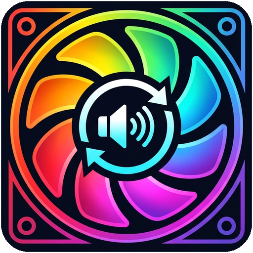
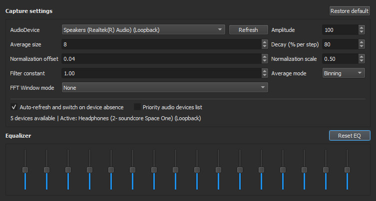
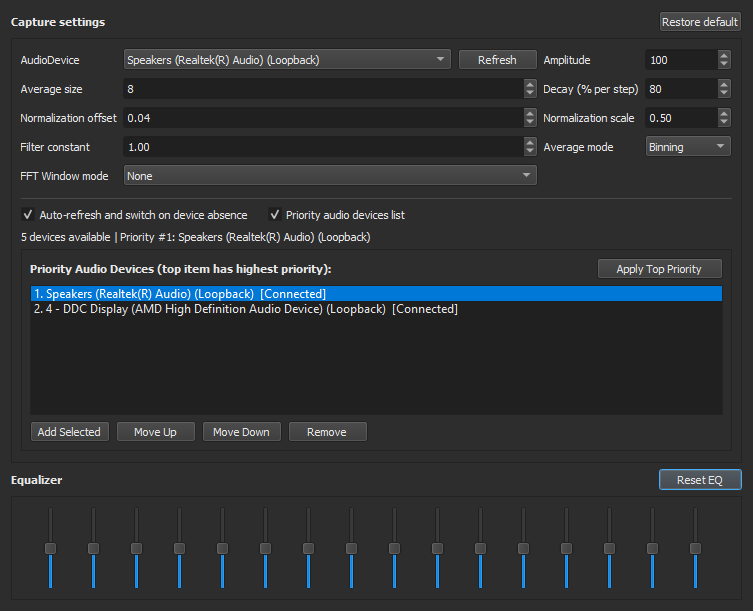
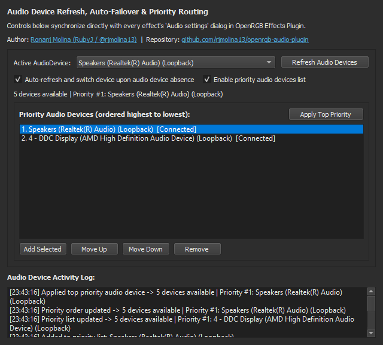

<!-- Improved compatibility of back to top link: See: https://github.com/othneildrew/Best-README-Template/pull/73 -->
<a id="readme-top"></a>

<!-- PROJECT SHIELDS -->
[![Contributors][contributors-shield]][contributors-url]
[![Forks][forks-shield]][forks-url]
[![Stargazers][stars-shield]][stars-url]
[![Issues][issues-shield]][issues-url]
[![GPL-2.0 License][license-shield]][license-url]


<!-- PROJECT LOGO -->
<br />
<div align="center">
  <a href="https://github.com/rjmolina13/openrgb-audio-plugin">
    
  </a>

<h3 align="center">OpenRGB Audio Refresh & Priority Plugin</h3>

  <p align="center">
    Hot-refresh Windows WASAPI audio endpoints, automatically fail over when an active audio device disconnects, and maintain a toggleable priority audio device list across all OpenRGB Effects Plugin audio effects.
    <br />
    <a href="https://github.com/rjmolina13/openrgb-audio-plugin"><strong>Explore the docs »</strong></a>
    <br />
    <br />
    <a href="https://github.com/rjmolina13/openrgb-audio-plugin#usage">View Screenshots</a>
    &middot;
    <a href="https://github.com/rjmolina13/openrgb-audio-plugin/issues/new?labels=bug">Report Bug</a>
    &middot;
    <a href="https://github.com/rjmolina13/openrgb-audio-plugin/issues/new?labels=enhancement">Request Feature</a>
  </p>
</div>


<!-- TABLE OF CONTENTS -->
<details>
  <summary>Table of Contents</summary>
  <ol>
    <li>
      <a href="#about-the-project">About The Project</a>
      <ul>
        <li><a href="#built-with">Built With</a></li>
      </ul>
    </li>
    <li>
      <a href="#getting-started">Getting Started</a>
      <ul>
        <li><a href="#prerequisites">Prerequisites</a></li>
        <li><a href="#installation">Installation</a></li>
      </ul>
    </li>
    <li><a href="#usage">Usage</a></li>
    <li><a href="#roadmap">Roadmap</a></li>
    <li><a href="#contributing">Contributing</a></li>
    <li><a href="#license">License</a></li>
    <li><a href="#contact">Contact</a></li>
    <li><a href="#acknowledgments">Acknowledgments</a></li>
  </ol>
</details>


<!-- ABOUT THE PROJECT -->
## About The Project

[![OpenRGB Audio Refresh & Priority Plugin Screen Shot][product-screenshot]](https://github.com/rjmolina13/openrgb-audio-plugin)

`OpenRGBEffectsPlugin` enumerates Windows WASAPI audio devices only once inside `AudioManager::AudioManager()` when OpenRGB starts. If you connect Bluetooth headphones, unplug a USB DAC, or switch monitors while OpenRGB is running, the `AudioDevice` dropdown inside effect `Audio settings` dialogs stays frozen until you restart OpenRGB.

`OpenRGBAudioRefreshPlugin` solves this as a standalone OpenRGB plugin (`API Version 4`) that augments `OpenRGBEffectsPlugin` at runtime without modifying files inside `C:\Program Files\OpenRGB`:

* **Refresh button on audio devices:** Injects a `Refresh` button directly beside the `AudioDevice` selector in every effect's `Audio settings` dialog (`AudioVisualizer`, `AudioSine`, `AudioStar`, `AudioParty`, `AudioVUMeter`, `AudioSync`, `AudioBubbles`, `SwirlCirclesAudio`, `Shaders`, and `GlobalSettings`). Clicking `Refresh` safely pauses active capture threads, calls `AudioManager::InitAudioDeviceList()` in-place, and repopulates every dropdown.
* **Automatic refresh and device failover on absence:** Registers a Windows CoreAudio `IMMNotificationClient` listener for endpoint state changes, additions, removals, and default console device switches. When the currently active device becomes absent (unplugged, disabled, or removed), the plugin automatically refreshes the device list and switches active effects to the next available endpoint.
* **Toggleable priority audio devices list:** Adds an expandable ordered priority list showing live `[Connected]` and `[Absent]` status indicators with `Add Selected`, `Move Up`, `Move Down`, `Remove`, and `Apply Top Priority` controls, persisted in `%APPDATA%\OpenRGB\plugins\settings\AudioRefreshSettings.json`.

<p align="right">(<a href="#readme-top">back to top</a>)</p>


### Built With

* [![C++17][Cpp-badge]][Cpp-url]
* [![Qt 5.15.0][Qt-badge]][Qt-url]
* [![Windows WASAPI][Windows-badge]][Windows-url]
* [![OpenRGB SDK][OpenRGB-badge]][OpenRGB-url]

<p align="right">(<a href="#readme-top">back to top</a>)</p>


<!-- GETTING STARTED -->
## Getting Started

You can install the prebuilt `OpenRGBAudioRefreshPlugin.dll` directly into your OpenRGB user plugins directory or compile it from source using Visual Studio 2022 Build Tools and Qt 5.15.0.

### Prerequisites

* **OpenRGB** `0.9+` / `1.0rc3` (64-bit Windows, Plugin API Version `4`) with **OpenRGB Effects Plugin** installed
* **Visual Studio 2022 Build Tools** (`Desktop development with C++`, MSVC x64 `cl.exe`) if building from source
* **Qt 5.15.0** (`win64_msvc2019_64` `qtbase`) if building from source:
  ```powershell
  pip install aqtinstall
  python -m aqt install-qt windows desktop 5.15.0 win64_msvc2019_64 -O .\qt5 --archives qtbase
  ```

### Installation

1. Clone the repository with its submodules (`ref/OpenRGBEffectsPlugin`):
   ```sh
   git clone --recurse-submodules https://github.com/rjmolina13/openrgb-audio-plugin.git
   cd openrgb-audio-plugin
   ```
   If you already cloned the repository without `--recurse-submodules`, initialize and fetch the linked submodules:
   ```sh
   git submodule update --init --recursive
   ```
2. Build `OpenRGBAudioRefreshPlugin.dll` from source (or use `build\OpenRGBAudioRefreshPlugin.dll`):
   ```bat
   .\build.bat
   ```
3. Copy `OpenRGBAudioRefreshPlugin.dll` into your OpenRGB user plugins folder:
   ```powershell
   Copy-Item -Force ".\build\OpenRGBAudioRefreshPlugin.dll" "$env:APPDATA\OpenRGB\plugins\OpenRGBAudioRefreshPlugin.dll"
   ```
4. Launch (or restart) `OpenRGB.exe`. OpenRGB automatically enables new plugins placed in `%APPDATA%\OpenRGB\plugins`.

<p align="right">(<a href="#readme-top">back to top</a>)</p>


<!-- USAGE EXAMPLES -->
## Usage

### 1. In-Effect Audio Settings Dialog (Compact View)
Open any audio-reactive effect in the **Effects** tab and click **Audio settings**. Use the **Refresh** button beside `AudioDevice` to re-scan Windows WASAPI loopback and capture endpoints on demand, or keep **Auto-refresh and switch on device absence** checked for automatic failover.



### 2. Toggleable Priority Audio Devices List
Check **Priority audio devices list** inside `Audio settings` to expand your ordered priority list. Select any device in the `AudioDevice` dropdown and click **Add Selected**, then arrange your preferred order with **Move Up**, **Move Down**, **Remove**, and **Apply Top Priority**.



### 3. Dedicated Settings Tab & Activity Log
Navigate to **Settings -> Audio Refresh & Priority** in OpenRGB to manage active audio endpoints, priority ordering, and inspect the timestamped **Audio Device Activity Log**. All changes synchronize across every open effect dialog and the OpenRGB system tray menu.



<p align="right">(<a href="#readme-top">back to top</a>)</p>


<!-- ROADMAP -->
## Roadmap

- [x] In-memory `AudioManager::InitAudioDeviceList()` re-enumeration for `OpenRGBEffectsPlugin.dll`
- [x] `Refresh` button injected into all effect `Audio settings` dialogs
- [x] Real-time Windows WASAPI `IMMNotificationClient` hotplug and device-absence failover
- [x] Toggleable ordered priority audio devices list with persistent JSON settings
- [ ] Linux PulseAudio / PipeWire hot-refresh backend support

See the [open issues](https://github.com/rjmolina13/openrgb-audio-plugin/issues) for a full list of proposed features and known issues.

<p align="right">(<a href="#readme-top">back to top</a>)</p>


<!-- CONTRIBUTING -->
## Contributing

Contributions are welcome. If you have a bug fix or improvement, fork the repository and open a pull request, or open an issue with the `enhancement` label.

1. Fork the Project
2. Create your Feature Branch (`git checkout -b feature/AudioEnhancement`)
3. Commit your Changes (`git commit -m 'Add AudioEnhancement'`)
4. Push to the Branch (`git push origin feature/AudioEnhancement`)
5. Open a Pull Request

<p align="right">(<a href="#readme-top">back to top</a>)</p>

### Top contributors:

<a href="https://github.com/rjmolina13/openrgb-audio-plugin/graphs/contributors">
  
</a>


<!-- LICENSE -->
## License

Distributed under the GPL-2.0-or-later License. See [`LICENSE.txt`](LICENSE.txt) for more information.

<p align="right">(<a href="#readme-top">back to top</a>)</p>


<!-- CONTACT -->
## Contact

Ronanj Molina (RubyJ) - [@rjmolina13](https://github.com/rjmolina13) - rj.molina13@gmail.com

Website: [https://ronanj.site](https://ronanj.site)

Project Link: [https://github.com/rjmolina13/openrgb-audio-plugin](https://github.com/rjmolina13/openrgb-audio-plugin)

<p align="right">(<a href="#readme-top">back to top</a>)</p>


<!-- ACKNOWLEDGMENTS -->
## Acknowledgments

* [OpenRGB](https://gitlab.com/CalcProgrammer1/OpenRGB)
* [OpenRGBEffectsPlugin](https://gitlab.com/OpenRGBDevelopers/OpenRGBEffectsPlugin)
* [Best-README-Template](https://github.com/othneildrew/Best-README-Template)

<p align="right">(<a href="#readme-top">back to top</a>)</p>


<!-- MARKDOWN LINKS & IMAGES -->
[contributors-shield]: https://img.shields.io/github/contributors/rjmolina13/openrgb-audio-plugin.svg?style=for-the-badge
[contributors-url]: https://github.com/rjmolina13/openrgb-audio-plugin/graphs/contributors
[forks-shield]: https://img.shields.io/github/forks/rjmolina13/openrgb-audio-plugin.svg?style=for-the-badge
[forks-url]: https://github.com/rjmolina13/openrgb-audio-plugin/network/members
[stars-shield]: https://img.shields.io/github/stars/rjmolina13/openrgb-audio-plugin.svg?style=for-the-badge
[stars-url]: https://github.com/rjmolina13/openrgb-audio-plugin/stargazers
[issues-shield]: https://img.shields.io/github/issues/rjmolina13/openrgb-audio-plugin.svg?style=for-the-badge
[issues-url]: https://github.com/rjmolina13/openrgb-audio-plugin/issues
[license-shield]: https://img.shields.io/github/license/rjmolina13/openrgb-audio-plugin.svg?style=for-the-badge
[license-url]: https://github.com/rjmolina13/openrgb-audio-plugin/blob/main/LICENSE.txt
[product-screenshot]: images/openrgb_plugins_view.png
[Cpp-badge]: https://img.shields.io/badge/C%2B%2B-17-00599C?style=for-the-badge&logo=cplusplus&logoColor=white
[Cpp-url]: https://isocpp.org/
[Qt-badge]: https://img.shields.io/badge/Qt-5.15.0-41CD52?style=for-the-badge&logo=qt&logoColor=white
[Qt-url]: https://www.qt.io/
[Windows-badge]: https://img.shields.io/badge/Windows-WASAPI-0078D6?style=for-the-badge&logo=windows&logoColor=white
[Windows-url]: https://learn.microsoft.com/en-us/windows/win32/coreaudio/wasapi
[OpenRGB-badge]: https://img.shields.io/badge/OpenRGB-Plugin_API_v4-2D2D2D?style=for-the-badge
[OpenRGB-url]: https://openrgb.org/
